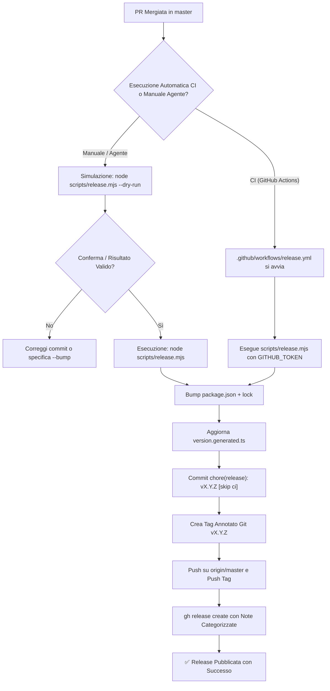

# 🚀 PR Release Skill (package.json + Git Tag + GitHub Release)

Questa skill definisce la procedura standardizzata per gestire il rilascio continuo ad ogni Pull Request mergiata in `master`:
1. Calcolo deterministico della nuova versione SemVer (`patch`, `minor`, `major`) a partire dai Conventional Commits del PR o dei commit inclusi.
2. Incremento e allineamento della versione in `package.json` e `package-lock.json`.
3. Rigenerazione dei file dipendenti dalla versione (`scripts/version.mjs` -> `src/app/core/version.generated.ts`).
4. Creazione del tag annotato Git immutabile (`vX.Y.Z`).
5. Push protetto su `origin/master` (con `ALLOW_PROTECTED_PUSH=1`).
6. Pubblicazione della GitHub Release con changelog formattato e categorizzato tramite `gh release create`.

---

## 🎯 Quando Attivare Questa Skill
Attiva questa skill in modo proattivo quando:
- Una Pull Request verso `master` è appena stata approvata e mergiata.
- L'utente chiede di: *"fare release"*, *"taggare"*, *"pubblicare la versione su github e package"*, *"creare la release post-merge"*.
- Si deve verificare in anteprima quale versione verrebbe generata (`--dry-run`).

---

## 💡 Perché Seguire Questa Procedura ("The Why")
1. **SemVer Rigoroso & Deterministico**: Evita errori umani nel determinare se una release è patch, minor o major. `feat:` diventa automaticamente `minor`, `fix:` / `chore:` diventa `patch`, e breaking changes (`!:` o `BREAKING CHANGE`) diventano `major`.
2. **Coerenza tra Codice e Release**: `package.json`, il tag Git `vX.Y.Z`, `version.generated.ts` e la GitHub Release rimangono perfettamente sincronizzati.
3. **Doppia Modalità (CI + CLI Agente)**:
   - **CI GitHub Actions** (`.github/workflows/release.yml`): scatta automaticamente quando un PR verso `master` viene chiuso con `merged == true`.
   - **CLI Locale / Agente** (`node scripts/release.mjs`): permette all'agente di simulare con `--dry-run` o eseguire il rilascio immediato quando richiesto dall'utente.

---

## 🗺️ Flusso Decisionale del Rilascio



---

## ⚡ Metodo Principale: Script Automatizzato (`scripts/release.mjs`)

Il repository include lo script deterministico `scripts/release.mjs` supportato dalla test suite in `scripts/release.test.mjs`.

### 1. Simulazione Preventiva (`--dry-run`)
Analizza i commit dall'ultimo tag semver fino a HEAD (o specificando una PR specifica con `--pr-number`), calcola la versione risultante e stampa l'anteprima delle release notes senza modificare file né creare tag:
```bash
# Simulazione su HEAD attuale
node scripts/release.mjs --dry-run

# Simulazione su una PR specifica
node scripts/release.mjs --dry-run --pr-number <PR_NUMBER>
```

### 2. Esecuzione Effettiva del Rilascio
Esegue l'aggiornamento di `package.json`, `package-lock.json`, crea il commit e il tag, effettua il push e pubblica la release su GitHub:
```bash
# Rilascio automatico basato sui commit
node scripts/release.mjs

# Rilascio specificando la PR mergiata
node scripts/release.mjs --pr-number <PR_NUMBER>

# Forzatura esplicita del tipo di incremento (patch, minor, major)
node scripts/release.mjs --bump minor
```

---

## 📋 Regole Conventional Commits per SemVer

Lo script classifica automaticamente le modifiche secondo le seguenti regole:

| Tipologia Commit | Esempio | Incremento SemVer | Sezione Changelog |
| :--- | :--- | :--- | :--- |
| **Breaking Change** | `feat!: ...` o footer `BREAKING CHANGE:` | **MAJOR** (`X.0.0`) | Sezione in evidenza |
| **Feature** | `feat: ...`, `feat(scope): ...` | **MINOR** (`x.Y.0`) | `### ✨ Features` |
| **Bug Fix** | `fix: ...`, `fix(scope): ...` | **PATCH** (`x.y.Z`) | `### 🐞 Bug Fixes` |
| **Altro** | `perf:`, `refactor:`, `style:`, `docs:`, `chore:` | **PATCH** (`x.y.Z`) | `### 🛠️ Maintenance & Other Changes` |

---

## 🤖 Automazione CI: `.github/workflows/release.yml`

Il workflow su GitHub Actions monitora ogni pull request chiusa su `master`:
- **Evento**: `pull_request.types = [closed]` con branch target `master`.
- **Condizione**: `github.event.pull_request.merged == true`.
- **Permessi**: `contents: write`, `pull-requests: read`.
- **Workflow dispatch**: supporta anche l'avvio manuale dall'interfaccia GitHub Actions specificando opzionalmente `pr_number` e `bump`.

---

## 🔍 Checklist di Verifica Post-Rilascio

Dopo aver completato un rilascio, verificare:
1. `git tag -l "v*" --sort=-v:refname` (il nuovo tag è presente localmente e su origin).
2. `git show HEAD` (il commit di release contiene `chore(release): vX.Y.Z [skip ci]`).
3. `gh release view vX.Y.Z` (la release è visibile con note e changelog comparativo su GitHub).
4. `npm run test:scripts` (i test degli script rimangono al 100% verdi).
