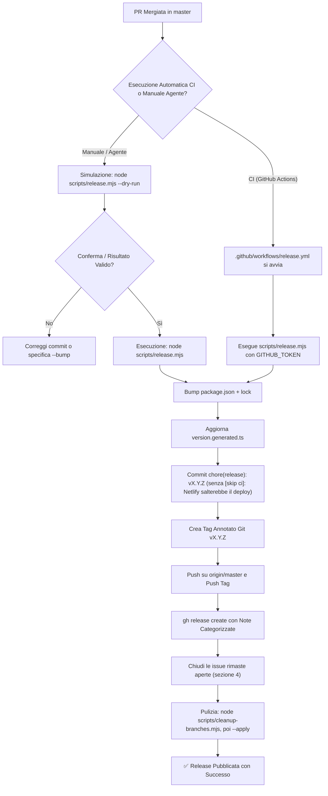

# 🚀 PR Release Skill (package.json + Git Tag + GitHub Release)

Questa skill definisce la procedura standardizzata per gestire il rilascio continuo ad ogni Pull Request mergiata in `master`:
1. Calcolo deterministico della nuova versione SemVer (`patch`, `minor`, `major`) a partire dai Conventional Commits del PR o dei commit inclusi.
2. Incremento e allineamento della versione in `package.json` e `package-lock.json`.
3. Rigenerazione dei file dipendenti dalla versione (`scripts/version.mjs` -> `src/app/core/version.generated.ts`).
4. Creazione del tag annotato Git immutabile (`vX.Y.Z`).
5. Push protetto su `origin/master` (con `ALLOW_PROTECTED_PUSH=1`).
6. Pubblicazione della GitHub Release con changelog formattato e categorizzato tramite `gh release create`.

---

## 🎯 Quando Attivare Questa Skill
Attiva questa skill in modo proattivo quando:
- Una Pull Request verso `master` è appena stata approvata e mergiata.
- L'utente chiede di: *"fare release"*, *"taggare"*, *"pubblicare la versione su github e package"*, *"creare la release post-merge"*.
- Si deve verificare in anteprima quale versione verrebbe generata (`--dry-run`).

---

## 💡 Perché Seguire Questa Procedura ("The Why")
1. **SemVer Rigoroso & Deterministico**: Evita errori umani nel determinare se una release è patch, minor o major. `feat:` diventa automaticamente `minor`, `fix:` / `chore:` diventa `patch`, e breaking changes (`!:` o `BREAKING CHANGE`) diventano `major`.
2. **Coerenza tra Codice e Release**: `package.json`, il tag Git `vX.Y.Z`, `version.generated.ts` e la GitHub Release rimangono perfettamente sincronizzati.
3. **Doppia Modalità (CI + CLI Agente)**:
   - **CI GitHub Actions** (`.github/workflows/release.yml`): scatta automaticamente quando un PR verso `master` viene chiuso con `merged == true`.
   - **CLI Locale / Agente** (`node scripts/release.mjs`): permette all'agente di simulare con `--dry-run` o eseguire il rilascio immediato quando richiesto dall'utente.

---

## 🗺️ Flusso Decisionale del Rilascio



---

## ⚡ Metodo Principale: Script Automatizzato (`scripts/release.mjs`)

Il repository include lo script deterministico `scripts/release.mjs` supportato dalla test suite in `scripts/release.test.mjs`.

### 1. Simulazione Preventiva (`--dry-run`)
Analizza i commit dall'ultimo tag semver fino a HEAD (o specificando una PR specifica con `--pr-number`), calcola la versione risultante e stampa l'anteprima delle release notes senza modificare file né creare tag:
```bash
# Simulazione su HEAD attuale
node scripts/release.mjs --dry-run

# Simulazione su una PR specifica
node scripts/release.mjs --dry-run --pr-number <PR_NUMBER>
```

### 2. Esecuzione Effettiva del Rilascio
Esegue l'aggiornamento di `package.json`, `package-lock.json`, crea il commit e il tag, effettua il push e pubblica la release su GitHub:
```bash
# Rilascio automatico basato sui commit
node scripts/release.mjs

# Rilascio specificando la PR mergiata
node scripts/release.mjs --pr-number <PR_NUMBER>

# Forzatura esplicita del tipo di incremento (patch, minor, major)
node scripts/release.mjs --bump minor
```

### 3. Pulizia di Branch e Worktree (dopo ogni rilascio)
Il rilascio è finito solo dopo la pulizia, una volta che il workflow di release è verde. Lancia `scripts/cleanup-branches.mjs` (test in `scripts/cleanup-branches.test.mjs`, issue #448) da un worktree dentro la repo:
```bash
# Piano: fa fetch --prune e worktree prune, poi elenca cosa toglierebbe senza toccare niente
node scripts/cleanup-branches.mjs

# Esecuzione: rimuove i worktree, cancella i branch locali (-D) e quelli su origin (push --delete)
node scripts/cleanup-branches.mjs --apply
```
Toglie solo ciò che è sicuramente già entrato: un branch se una PR **merged** su GitHub ha come head esattamente la sua punta. Il controllo tramite PR verificate su GitHub assicura che solo i branch effettivamente mergiati vengano rimossi, mentre un commit aggiunto dopo il merge lo tiene in vita. Un worktree va via solo se sta su un branch così, è pulito (nemmeno file non tracciati), non è `locked`, non è il checkout principale, nessun processo ha la cwd al suo interno (lsof, quindi le sessioni aperte in altri worktree restano) e non contiene un worktree annidato da tenere. Non tocca mai `master`, `devel`, `v2` o `archive/*`: i branch di release non si eliminano da origin. Mostra il piano all'utente prima di `--apply`, e riporta ciò che lo script segnala come `kept` invece di forzarlo: niente `--force` e niente `git worktree remove --force`. Il worktree della sessione corrente resta, perché ci sta dentro questo processo; a fine sessione lo toglie l'utente.

### 4. Chiudere le issue rimaste aperte (dopo ogni rilascio, prima della pulizia)
GitHub esegue il `Closes #n` di una PR solo quando la PR viene mergiata nel branch di default (`master`). Le PR di lavoro vanno in `devel`, quindi le loro issue restano aperte. La PR di release `devel → master` non rilegge i `Closes` dei commit che porta dentro: dopo v2.7.0 erano rimaste aperte 17 issue già risolte (issue #529). A tag pubblicato, raccogli le issue delle PR entrate nella release e chiudi quelle ancora aperte:
```bash
new=vX.Y.Z; prev=$(git describe --tags --abbrev=0 "$new^")
git log --merges --format=%s "$prev..$new" | grep -oE 'pull request #[0-9]+' | grep -oE '[0-9]+' |
  while read pr; do
    gh pr view "$pr" --json closingIssuesReferences,headRefName \
      -q '(.closingIssuesReferences[].number), (.headRefName | capture("/(?<n>[0-9]+)-").n // empty)'
  done | sort -un |
  while read n; do
    [ "$(gh issue view "$n" --json state -q .state)" = OPEN ] || continue
    gh issue close "$n" --reason completed --comment "Released in $new (https://github.com/xdelmo/Portfolio-minimal/releases/tag/$new). Its PR targeted \`devel\`, so GitHub did not close it."
  done
```
Le fonti sono due: i `Closes #n` nel corpo delle PR (`closingIssuesReferences`) e il numero nel nome del branch (`fix/<n>-topic`). Prima di chiudere, rileggi l'elenco: un branch `<prefix>/<n>-…` che ha risolto solo una parte dell'issue la chiuderebbe troppo presto, e in quel caso la lasci aperta con un commento. In zsh usa `while read`, non `for n in $var`, che non divide le parole. L'esecuzione è finita quando, rilanciato senza `gh issue close`, il ciclo non stampa più issue `OPEN`.

---

## 📋 Regole Conventional Commits per SemVer

Lo script classifica automaticamente le modifiche secondo le seguenti regole:

| Tipologia Commit | Esempio | Incremento SemVer | Sezione Changelog |
| :--- | :--- | :--- | :--- |
| **Breaking Change** | `feat!: ...` o footer `BREAKING CHANGE:` | **MAJOR** (`X.0.0`) | Sezione in evidenza |
| **Feature** | `feat: ...`, `feat(scope): ...` | **MINOR** (`x.Y.0`) | `### ✨ Features` |
| **Bug Fix** | `fix: ...`, `fix(scope): ...` | **PATCH** (`x.y.Z`) | `### 🐞 Bug Fixes` |
| **Altro** | `perf:`, `refactor:`, `style:`, `docs:`, `chore:` | **PATCH** (`x.y.Z`) | `### 🛠️ Maintenance & Other Changes` |

---

## 🤖 Automazione CI: `.github/workflows/release.yml`

Il workflow su GitHub Actions monitora ogni pull request chiusa su `master`:
- **Evento**: `pull_request.types = [closed]` con branch target `master`.
- **Condizione**: `github.event.pull_request.merged == true`.
- **Permessi**: `contents: write`, `pull-requests: read`.
- **Workflow dispatch**: supporta anche l'avvio manuale dall'interfaccia GitHub Actions specificando opzionalmente `pr_number` e `bump`.

---

## 🔍 Checklist di Verifica Post-Rilascio

Dopo aver completato un rilascio, verificare:
1. `git tag -l "v*" --sort=-v:refname` (il nuovo tag è presente localmente e su origin).
2. `git show HEAD` (il commit di release è `chore(release): vX.Y.Z`, **mai** con `[skip ci]`/`[skip netlify]`: Netlify salterebbe il deploy e il footer resterebbe sulla versione precedente, issue #386).
3. `gh release view vX.Y.Z` (la release è visibile con note e changelog comparativo su GitHub).
4. Il sito live mostra la nuova versione nel footer, a deploy Netlify concluso: `curl -s https://www.emanueledelmonte.it/en/ | grep -o 'v[0-9]*\.[0-9]*\.[0-9]*' | head -1`.
5. `npm run test:scripts` (i test degli script rimangono al 100% verdi).
6. Le info della repo erano già aggiornate prima del merge (vedi sotto).
   Se la release tocca `handbook/**` o `mkdocs.yml` (solo allora `docs.yml` parte su `master`), l'handbook è ripubblicato: `gh run list --workflow docs.yml --branch master --limit 1` è verde e https://xdelmo.github.io/Portfolio-minimal/ mostra le pagine aggiornate.
7. Nessuna issue risolta dalla release è ancora aperta (sezione "Chiudere le issue rimaste aperte").
8. `node scripts/cleanup-branches.mjs` non elenca più niente da togliere, a parte ciò che `--apply` ha segnalato come `kept` e i worktree ancora in uso (sezione "Pulizia di Branch e Worktree").

---

## 📝 Aggiornare le Info della Repo (prima di ogni rilascio)

Prima di fare il merge della PR di release in `master`, aggiorna ciò che descrive la repo, così entra già nella versione rilasciata. Confronta le note in anteprima (`node scripts/release.mjs --dry-run`) con lo stato attuale:
1. **GitHub**: `gh repo view --json description,homepageUrl,repositoryTopics`; se descrizione, homepage o topic non descrivono più il progetto (stack, funzionalità aggiunte o tolte), correggili con `gh repo edit --description … --homepage … --add-topic … --remove-topic …`.
2. **README.md** (e `CLAUDE.md`, `PRODUCT.md`, `DESIGN.md` se toccati): togli ciò che la release ha rimosso, aggiungi ciò che ha introdotto, aggiorna versioni e stack citati. Le modifiche ai file passano da un branch `docs/<topic>` e da una PR in `devel` come ogni altra modifica, mai da un commit diretto su `master`; la PR di release ripete la sua CI dopo quel merge, e solo allora si fa il merge in `master`.
3. **Handbook MkDocs** (`handbook/**` e `mkdocs.yml`, pubblicato su https://xdelmo.github.io/Portfolio-minimal/ da `.github/workflows/docs.yml` a ogni push su `master`): rileggi `index.md`, `architettura.md`, `decisioni/*` e `guida/*` alla luce delle note e aggiorna ciò che la release cambia (una decisione tecnica nuova o rivista, comandi, script, workflow, CI); una pagina nuova va anche nel `nav` di `mkdocs.yml`, e `site_description` deve ancora descrivere il sito. È pubblico e in italiano: niente segreti, URL di hook, indirizzi e-mail, percorsi locali, nomi di repo private né contenuti da `docs/launch/`, `docs/superpowers/` o `.claude/`. Prima della PR: `node scripts/handbook-check.mjs`, poi `python3 -m venv .venv && .venv/bin/pip install -r handbook/requirements.txt && .venv/bin/mkdocs build --strict`. Passa dallo stesso branch `docs/<topic>` del punto 2.
4. Il branch di release (`devel`) non si elimina mai da origin: merge della PR di release senza `--delete-branch`.
