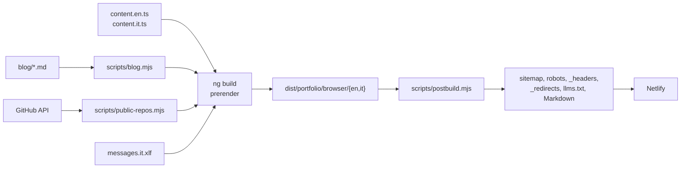

# Architettura

Il sito è un'applicazione Angular che non gira mai su un server: al build ogni pagina viene renderizzata in HTML statico per ciascuna lingua, poi idratata nel browser.

## Dal sorgente al deploy

1. **Generazione** (`npm run generate`, eseguito da build, start, verify e `npm install`): `scripts/blog.mjs` trasforma i post Markdown in un modulo TypeScript, `scripts/public-repos.mjs` chiede a GitHub quali repository sono pubblici.
2. **Build**: `ng build` prerenderizza entrambe le lingue in `dist/portfolio/browser/en` e `/it`.
3. **Post-build**: `scripts/postbuild.mjs` legge le pagine prerenderizzate e scrive sitemap, `robots.txt`, gli header (CSP inclusa), le rewrite per i case study, `llms.txt` e una copia Markdown di ogni pagina.
4. **Deploy**: Netlify serve la cartella statica e applica i redirect di `netlify.toml`.

## Struttura del codice

| Cartella | Cosa contiene |
|---|---|
| `src/app/core/` | logica pura e testata (tema, lingua, SEO) con servizi sottili attorno |
| `src/app/content/` | i contenuti per lingua, i post del blog e i file generati |
| `src/app/pages/`, `sections/`, `layout/` | pagine, sezioni della home, header e footer |
| `src/app/motion/` | il caricatore di GSAP, la direttiva `[appMotion]` e gli effetti |
| `src/app/pixel-field/`, `pixel-dissolve/`, `voxel/` | la nuvola di pixel, le cuciture tra sezioni, il moai 3D |
| `src/app/game/` | l'easter egg «Press start» |
| `src/styles/` | token di colore, breakpoint, font |
| `scripts/` | build, postbuild, controlli e i loro test |
| `e2e/` | i test Playwright |

## Principi

- **La logica che può rompersi vive in funzioni pure** accanto a servizi sottili: `core/theme/theme.ts`, `core/i18n/locale.ts`, `core/seo/seo.ts` hanno test unitari, i servizi si limitano a collegarle ad Angular.
- **Un solo sorgente per ogni contenuto**: pagine, Markdown per gli agenti, `llms.txt` e immagini Open Graph nascono dagli stessi file.
- **Tutto ciò che è pesante è lazy**: GSAP, Three.js, il player card e i contenuti di ogni lingua sono chunk separati.
- **Ogni regressione arrivata in CI lascia una guardia**: una regola di lint, un test o un controllo in uno script.

## Netlify

`netlify.toml` gestisce:

- il redirect di lingua su `/`, che rispetta il cookie `nf_lang` scritto dal selettore di lingua;
- i 301 verso il dominio canonico e dai vecchi URL del sito Gatsby;
- le pagine 404 per lingua.

`_redirects`, generato al build, aggiunge rewrite 200 così i case study rispondono al loro URL canonico senza barra finale, senza un 301 in più.
