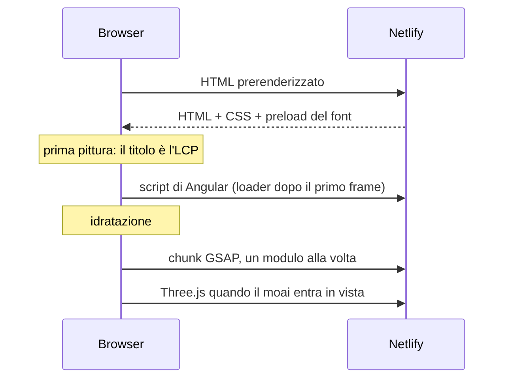

# Prima pittura e Lighthouse

La CI richiede Lighthouse mobile ≥ 0.95 (il migliore di tre run). L'LCP della home è il titolo dell'hero, cioè testo: tutto ciò che parte prima della prima pittura finisce sul percorso critico.

## Cosa resta fuori dal percorso critico

- **GSAP** si importa solo dopo la prima pittura.
- **Le immagini dei progetti** non sono mai `priority`: l'hero riempie il primo schermo.
- **`index.preloadInitial` è spento.**
- **Gli script di Angular**: `scripts/after-paint.mjs` (nel postbuild) sostituisce i module script e i modulepreload con un unico loader inline che li avvia dopo il primo frame. Risultato: FCP da 1.9 a 1.2 s.
- **Three.js, il player card e la musica** sono chunk lazy; il sintetizzatore si scarica solo alla prima accensione.

## Cambio pagina

- `withPreloading(IdlePreload)` scarica i chunk di tutte le pagine quando la pagina è caricata e il browser è inattivo; mai con Save-Data.
- Se un cambio pagina richiede comunque più di 200 ms, nell'header compare una barra a scatti. Il ritardo è in CSS, non in un timer, e la barra non compare mai alla prima navigazione.
- La transizione fa salire la nuova pagina come un foglio sopra la vecchia, che si scurisce, mentre l'header resta fermo.

## CLS a zero

- Instrument Sans è self-hosted con `font-display: optional`, e il postbuild inietta un `<link rel="preload">` del file latino in ogni pagina. Il CSS del pacchetto usa `swap`, che sposterebbe il testo.
- Ogni immagine ha `width` e `height` nei file di contenuto.

## Immagini

Le immagini dei progetti sono WebP (circa un terzo del JPEG): l'originale a piena larghezza più una copia a metà larghezza, da cui `workImageLoader` costruisce il `srcset`.

## Cache

Il postbuild dà a ogni file con hash un anno di cache `immutable` tramite `_headers`.

